# StretchMaster Database ERD



## Files

- `schema.mmd`: editable Mermaid source.
- `erd.svg`: generated database diagram.
- `../../scripts/render_erd.mjs`: renderer adapted from Dylan's Assignment 4.

The diagram uses Aarav's table definitions and adds crow's-foot relationships with minimum and maximum cardinalities.

## Relationship assumptions

- Each program belongs to one user.
- Each session belongs to one user and one program.
- Each measurement belongs to one session and one stretch.
- A parent record can have zero or many related child records.
- PROGRAM_STRETCH connects programs and stretches. Its composite primary key allows each stretch to appear once per program.

These assumptions should stay aligned with the database implementation.

## Regenerating the diagram

The renderer requires Node.js and an installed Mermaid CLI (`@mermaid-js/mermaid-cli`).

From the repository root, if Mermaid CLI is installed in this project's node_modules:

```bash
node scripts/render_erd.mjs
```

To reuse an existing Assignment 4 installation in WSL:

```bash
MERMAID_CLI="$HOME/fall-2026-assignment-04/node_modules/.bin/mmdc" node scripts/render_erd.mjs
```

After editing schema.mmd, regenerate erd.svg and commit both files.